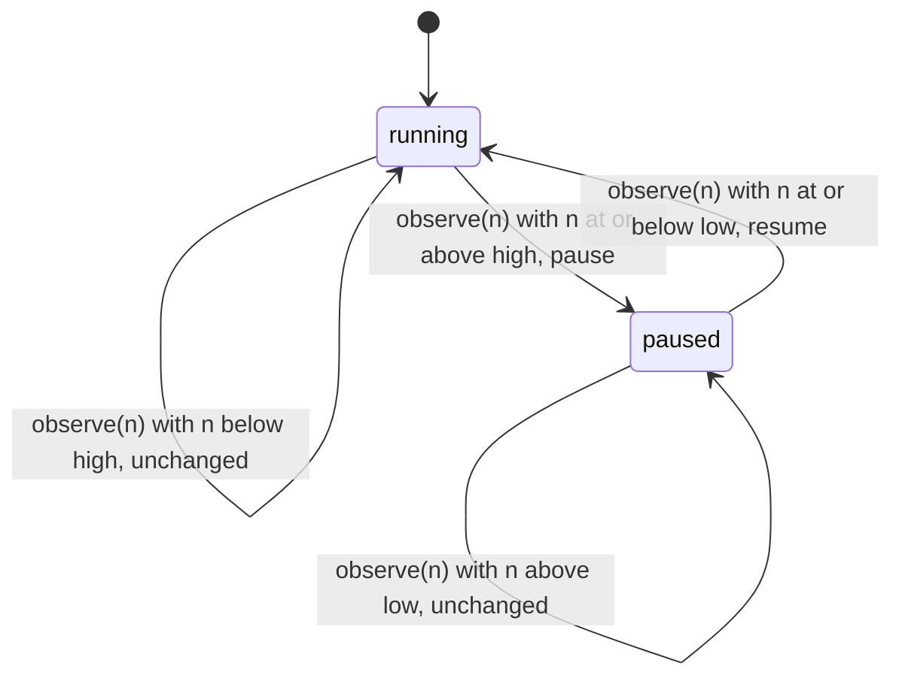
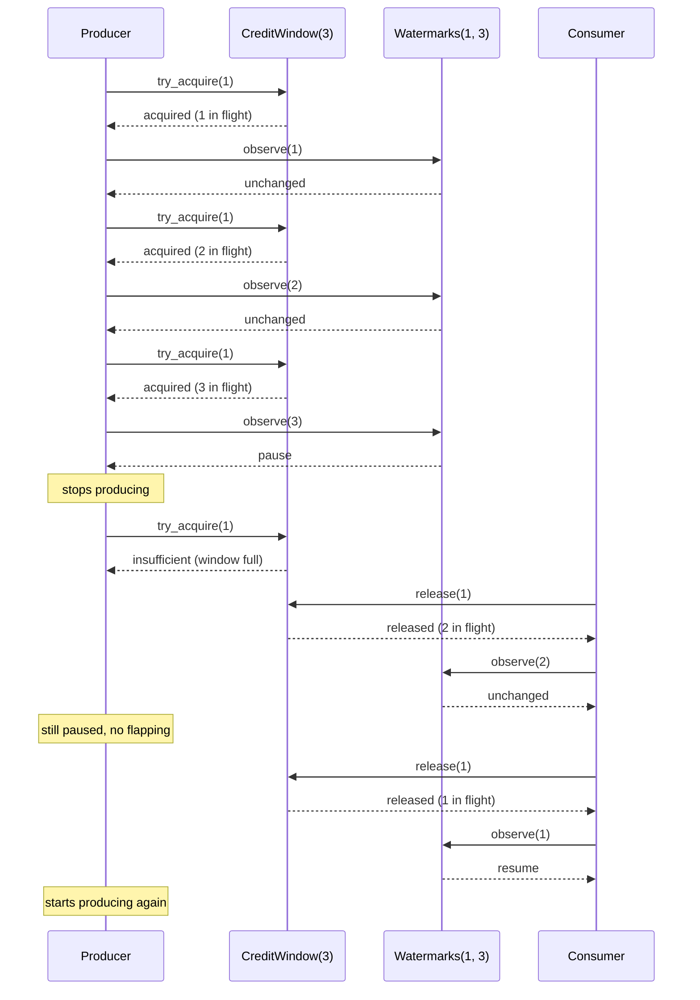

# FlowMachines

> Your producer has a bigger engine than your consumer. Somebody has to say "hold." 🌊

Backpressure for Ruby, in two small parts. A `CreditWindow` counts how much work is allowed in flight and refuses anything past the line. A `Watermarks` controller watches a queue's occupancy and tells you when to pause the producer and when it's safe to resume, without flapping between the two every time the count twitches.

## Quick Start

```bash
gem 'flow_machines'
```

```ruby
window  = FlowMachines::CreditWindow.new(100)
control = FlowMachines::Watermarks.new(20, 80)

# Producer side: ask before you enqueue.
def enqueue(job)
  return false unless window.try_acquire(1) == :acquired
  queue << job
  producer.pause if control.observe(queue.length) == :pause
  true
end

# Consumer side: give the credit back when the work is done.
def finish(job)
  queue.delete(job)
  window.release(1)
  producer.resume if control.observe(queue.length) == :resume
end
```

The window stops the queue from growing past 100. The watermarks tell the producer to stop at 80 and start again at 20. Everything in between is your queue and your producer. The gem only decides.

## A Message to the Resistance

So the ingest service got faster. Good news, until the worker pool behind it started falling over every evening at seven.

You know the shape of this one. The producer runs at whatever speed the producer runs at. The consumer runs slower. The gap goes into a queue, and the queue goes into memory, and memory is finite, and at seven the OOM killer arrives like a bailiff. Nobody wrote a bug. Everything did its job. The system just never had a word for "enough."

The first fix everyone reaches for is a hard cap: drop the job when the queue is full. That's load shedding, and sometimes it's right. But if the jobs matter, dropping them just moves the outage to wherever those jobs were supposed to land.

The second fix is to tell the producer to slow down. That's backpressure, and it needs two things: a count that actually limits what's in flight, and a signal that says "pause" at one level and "resume" at a lower one, so the producer isn't toggled on and off a thousand times a second as the count hovers around the line.

Those two things are this gem.

## Chapter 1: Stardate 2025.186, the AMS Cerf

> **AMS Cerf**, NCC-4209, *Cerf*-class traffic escort.
> Count the berths before inviting the next freighter through the gate.

The escort doesn't fly the freighters and doesn't own the dock. It keeps the count of berths, issues a credit for each one, and raises the hold signal when the approach lane fills up. Captains who ignore the signal still crash. Captains who obey it never do.

Somewhere in the approach lane, a freshly commissioned lieutenant files a flight plan:

```ruby
loop do
  job = upstream.next
  queue.push(job)   # "Ruby arrays grow automatically, it's fine"
end
```

"That," says the dock master, "is how a lane becomes a debris field."

## The Flight Plan

The watermarks controller has two states and moves between them only at the edges.



And an evening at the dock, with a window of 3 and watermarks at 1 and 3:



## The Credit Window

A window has a capacity. Acquiring takes units out of it, releasing puts them back. Both are all-or-nothing.

```ruby
window = FlowMachines::CreditWindow.new(3)
window.capacity    # => 3
window.in_flight   # => 0
window.available   # => 3

window.try_acquire(2)   # => :acquired
window.try_acquire(2)   # => :insufficient, only 1 left and we asked for 2
window.in_flight        # => 2
window.available        # => 1
```

A refused acquire takes nothing. There is no partial grant, so you never have to figure out how much you actually got. Both answers are symbols, and both are truthy: compare against `:acquired`, don't write `if window.try_acquire(1)`.

Release is the same deal in reverse:

```ruby
window.release(3)   # => :exceeds_in_flight, only 2 are out
window.release(2)   # => :released
window.release(1)   # => :exceeds_in_flight, nothing is out
window.available    # => 3
```

The window is a count, not a ledger. It doesn't know who acquired what, so it cannot tell a repeated release from a legitimate one: release the same job twice and the second call answers `:released` too, as long as anything is still out, and quietly hands back somebody else's credit. Only when nothing is left does it answer `:exceeds_in_flight`. If your code acquires on enqueue and forgets to release on a cancelled job, the window will slowly fill with ghosts. Release every unit you acquire exactly once, including on the error path.

## The Watermarks

A watermarks controller starts running. Feed it the current occupancy after every change and it answers with one of three words.

```ruby
control = FlowMachines::Watermarks.new(2, 5)
control.state        # => :running

control.observe(4)   # => :unchanged
control.observe(5)   # => :pause
control.state        # => :paused
control.observe(5)   # => :unchanged, already paused
control.observe(3)   # => :unchanged, above low, stay paused
control.observe(2)   # => :resume
control.observe(0)   # => :unchanged
```

The gap between `low` and `high` is the whole point. A controller that paused at 5 and resumed at 4 would flap every time one job finished. This one pauses at 5 and won't resume until the queue drains to 2. That's hysteresis, and it's why your producer doesn't get whiplash.

`:pause` and `:resume` are edges. You get each one once per crossing. If a producer connects late and missed the edge, ask `state` instead of waiting for a signal that already went by.

Occupancy is whatever you want to measure. Queue length is the obvious choice. Bytes buffered, open connections, or outstanding requests all work just as well, as long as you measure the same thing every time.

## Putting Them Together

The window and the controller don't know about each other. You wire them around your queue. Here's a cancellation path, the one everyone forgets:

```ruby
window  = FlowMachines::CreditWindow.new(4)
control = FlowMachines::Watermarks.new(1, 3)
queue   = []

3.times do |id|
  window.try_acquire(1)
  queue << id
  control.observe(queue.length)   # :unchanged, :unchanged, :pause
end
control.state                     # => :paused

# A job is cancelled before it ever ran. Still a release.
queue.pop
window.release(1)                 # => :released
control.observe(queue.length)     # => :unchanged, 2 is above low

# One finishes normally.
queue.shift
window.release(1)                 # => :released
control.observe(queue.length)     # => :resume
window.in_flight                  # => 1, same as queue.length
```

If the cancelled job hadn't released its credit, `in_flight` would read 2 while the queue held 1, and the window would be one berth short forever.

### Every answer

A call that is honoured answers with a value. A call that is not honoured answers with one of the refusal symbols below, and only those, and changes nothing. Each refusal is the snake_case of one core `Refusal` variant; there is no catch-all symbol, and a refusal never raises.

| Call | Honoured | Refusals |
| --- | --- | --- |
| `CreditWindow#try_acquire(units)` | `:acquired` | `:insufficient` (`units` is more than `available`) |
| `CreditWindow#release(units)` | `:released` | `:exceeds_in_flight` (`units` is more than `in_flight`) |
| `Watermarks#observe(occupancy)` | `:pause`, `:resume`, `:unchanged` | none |

`CreditWindow.new(capacity)`, `capacity`, `in_flight`, `available` and `Watermarks#state` (`:running` or `:paused`) never refuse. `Watermarks.new(low, high)` answers a controller or raises `RangeError` unless `low < high`.

No answer records a clock: neither object takes one, so every answer depends only on the counts.

## The Rules of the Escort

- **Counts are Integers** in `0..4_294_967_295`. Capacity, acquire and release units, and `high` must be at least 1. Floats and strings raise `TypeError`; zero where 1 is the minimum, negatives and anything past the range raise `RangeError`.
- **Thresholds obey `0 <= low < high`.** Equal thresholds or a reversed pair raise `RangeError`. A `low` of zero is fine: resume only when fully drained.
- **Positional, like the core.** `CreditWindow.new(capacity)` and `Watermarks.new(low, high)`, in that order. There are no keywords and no defaults. Pass a Hash where a count belongs and the `TypeError` names the argument: `capacity must be an Integer, not Hash`.
- **Exceptions are two.** Wrong type is `TypeError`, a value the core does not accept is `RangeError`, and both messages name the argument. `ArgumentError` only ever comes from Ruby itself, for arity.
- **Conversions come first.** Every argument is checked before the core is called, and after it the binding only turns the core's answer into a symbol, so a raise never costs a credit.
- **A refusal is a symbol, and nothing changed.** `:insufficient` and `:exceeds_in_flight` leave `in_flight` and `available` exactly as they were. Nothing is granted or returned in part.
- **No repeat is recognised.** Credits are an aggregate count with no owner, so the window cannot prove that a release, or an acquire, is a replay of an earlier one. Every call is counted. Releasing each unit exactly once is yours to get right.
- **`:unchanged` is an answer, not a refusal.** `observe` accepts every reading. `:pause` and `:resume` moved the state; `:unchanged` left it alone.
- **No clock, no handles.** Neither object reads time or issues ids, so there is nothing to scope and nothing to resume after a restart: rebuild the window and re-acquire what is still in flight.
- **Malformed input changes nothing.** Pass the controller a float and it raises, but its state is exactly what it was before.
- **No copies.** `dup` and `clone` raise `TypeError`. Live accounting isn't something you want two of.
- **Frozen means frozen.** `freeze` either object and every mutation raises `FrozenError`.

## What You Think You're Doing vs Reality

### You Think: "I'll cap the queue and drop what doesn't fit."
### Reality: You've moved the outage downstream and called it resilience.

Dropping is a fine answer when the work is disposable. When it isn't, every dropped job is a retry somewhere else, a reconciliation report, or a customer email. Backpressure keeps the work and slows the source. Pick the one that matches what the jobs are worth.

### You Think: "Pause at 80, resume at 79, nice and responsive."
### Reality: Your producer now has a 79-to-80 oscillation you can hear from the next room.

One finished job resumes the producer. One enqueued job pauses it. Repeat a few thousand times a second. The gap between `low` and `high` is not slack. It's the thing that makes the signal mean something.

## What's Yours

The gem decides. It doesn't enqueue, dequeue, block, sleep, spawn threads, or talk to another process. Your queue is yours, your producer is yours, and so is making the producer actually stop when it hears `:pause`. If the window and the queue are touched from more than one thread, wrap the acquire-and-push and the pop-and-release in your own lock so the count and the queue never disagree.

## License

MIT License. See [LICENSE.txt](LICENSE.txt) for details.

**Remember: A queue that can grow forever is just an outage with a delay on it.**
